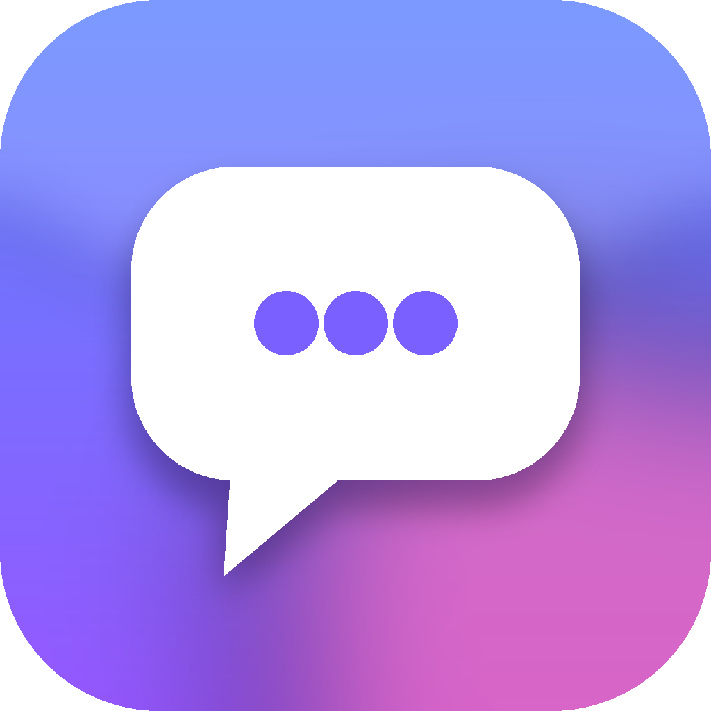
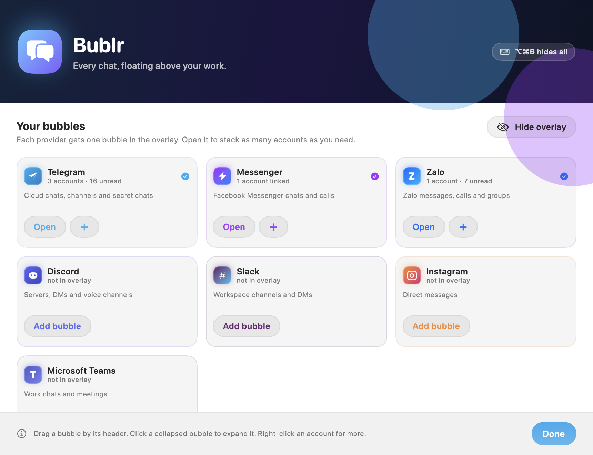
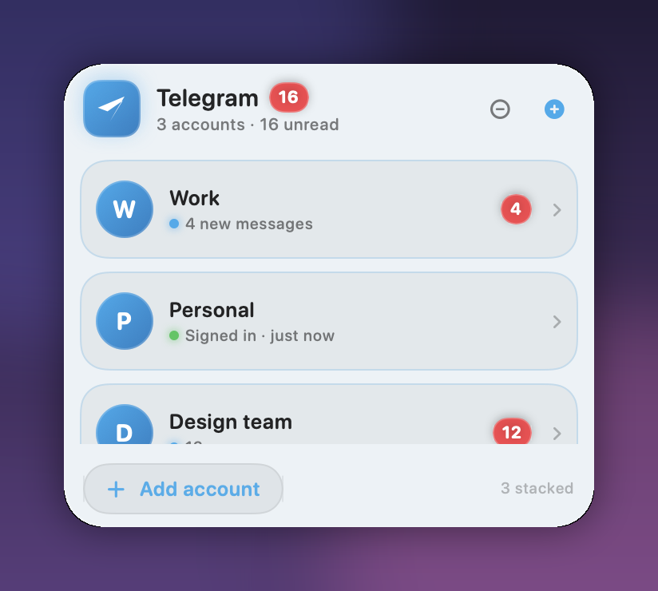
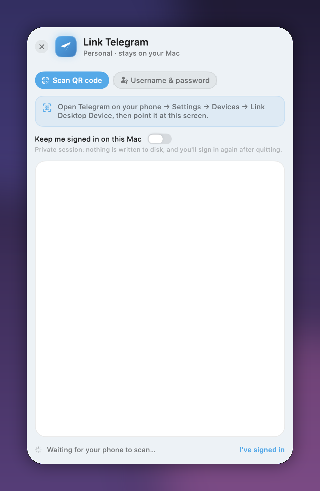

<p align="center">
  
</p>

<h1 align="center">Bublr</h1>

<p align="center"><em>Every chat, floating above your work.</em></p>

<p align="center">
  <strong>Chat heads for macOS</strong> — a native overlay that keeps one always-on-top bubble per chat
  provider: Telegram, Messenger, Zalo, Discord, Slack, Instagram, Teams, or any web chat, with every
  account you own stacked inside it.
</p>

<p align="center">
  
  
  <a href="LICENSE"></a>
  
  
</p>



Bublr is a chat-head overlay for macOS: each conversation is a small bubble floating above your work, and
you put it where you want it. It is an AppKit + SwiftUI menu-bar agent (`LSUIElement`) — no Dock icon — and
each bubble is a borderless panel that follows you across Spaces. Each account inside a bubble is a **real,
isolated browser session** against the provider's own web client, so you sign in through Telegram's QR
code, Messenger's password form or Zalo's QR exactly as you would in a browser tab, and the provider you
already trust keeps doing the talking.

| Provider bubble | Sign-in |
| --- | --- |
|  |  |

*Screenshots use sample data from `--seed-demo` / `--render-ui`; no real accounts.*

> **Status:** 1.0.0. The app is used daily by its author, and `make test` covers the parts that break
> silently. There is no notarised binary yet — until there is, a downloaded build needs a right-click to open.

## Contents

- [Why Bublr](#why-bublr)
- [Non-goals](#non-goals)
- [Install](#install)
- [Using it](#using-it)
- [Providers](#providers)
- [Privacy](#privacy)
- [How it works](#how-it-works)
- [Development](#development)
- [Testing](#testing)
- [Project layout](#project-layout)
- [Contributing](#contributing)
- [Licence](#licence)

## Why Bublr

**Every chat app wants to be a separate window you switch to.** If you live in more than one — work
Telegram, a family group on Zalo, a studio channel on Messenger — you end up alt-tabbing between
applications that all do the same thing. Bublr puts each one in a small panel that stays where you left it,
over the work you are actually doing.

- **Not a scraper, not a bridge.** No unofficial API, no bot token, no reverse-engineered protocol that
  breaks every other week. It is the provider's own web client in a web view — the same one you would open
  in a browser tab.
- **One session per account.** Work and personal Telegram live in separate `WKWebsiteDataStore`s, so
  signing out of one never touches the other, and two accounts of the same provider never see each other.
- **Glanceable.** Collapsed to a circle, a bubble shows an unread badge; expanded, it lists your accounts;
  opened, it is the real chat. Drag it anywhere, and it stays there across launches and Spaces.
- **No credentials, ever.** See [Privacy](#privacy).

## Non-goals

Being explicit about what this is not saves everyone a pull request:

- **Not a messaging client.** There is no custom UI for chats, no message database, no notifications
  pipeline. You are looking at the provider's page, which is the point: their features arrive when they
  ship them, not when this project catches up.
- **Not Android chat heads.** "Chat heads" is the closest familiar name for the pattern, not a promise of
  Android parity. Nothing here follows a notification around the screen: a bubble is a conversation you
  place deliberately, and it stays there until you move it.
- **Not a proxy or a scraper.** Bublr never intercepts, proxies or reads a login form, and never calls a
  private endpoint. If a provider ships a protocol change, nothing here needs to change.
- **Not a Chromium wrapper.** WebKit is the only engine, which is why WhatsApp — whose web client requires
  Chromium and serves a "download WhatsApp" page inside WebKit — is not offered.
- **No telemetry, analytics or update pings.** Nothing phones home, because there is nothing to phone home
  to.

## Install

### Download

Grab `Bublr-<version>.dmg` from [Releases](https://github.com/nnnghia98/bublr/releases), open it, drag **Bublr**
onto the Applications shortcut, and launch it. The DMG carries an ad-hoc signature and is **not notarised yet**,
so the first launch needs a right-click → *Open* — or one command:

```bash
xattr -d com.apple.quarantine /Applications/Bublr.app
```

### Homebrew

`make release` writes `dist/bublr.rb`, a cask pinned to that DMG's sha256. Drop it into a `homebrew-bublr` tap
as `Casks/bublr.rb` and it installs with:

```bash
brew install --cask nnnghia98/bublr/bublr
```

### From source

Requirements: **macOS 14 (Sonoma) or newer**, **Xcode 15 or newer**, and
[xcodegen](https://github.com/yonaskolb/XcodeGen).

```bash
brew install xcodegen
git clone https://github.com/nnnghia98/bublr.git
cd bublr
make build
make install     # copies Bublr.app to /Applications
make reinstall   # after merging: quit, rebuild Release, install, relaunch
open /Applications/Bublr.app
```

No Accessibility, screen-recording or other TCC permission is needed. The app has no Dock icon: it lives in
the menu bar.

## Using it

1. The welcome window lists providers. Pick one — its bubble appears at the right edge of the screen with the
   provider's own sign-in page already open.
2. Sign in the way the provider allows (QR or password). Bublr notices by itself and drops you into the chat.
3. **Add account** on a bubble stacks another account for that provider, with its own isolated session.
   **Duplicate bubble** (right-click the header, or the menu bar) opens a second head over the same
   accounts when you want the same chats visible in two places.
4. Drag a bubble by its header (or by the circle when collapsed); collapse with the minus button; pop an
   account out from its context menu. Clicking anywhere outside the bubbles collapses them all — turn that
   off with *Collapse bubbles when I click away* in the menu bar.
5. A provider with no accounts has no bubble on the overlay; right-click a bubble's header to hide or show
   that provider by hand.
6. Clicking an account opens its chat **beside** the head rather than in place of it, so the head keeps its
   badge, its name and its handle. Drag the head and the chat comes with it; *Chat opens* in the same
   right-click menu pins the side, or leaves it automatic.
7. Drag any edge or corner of a chat or an account list to resize it, live. Sizes stick per bubble.

| Action | How |
| --- | --- |
| Show / hide every bubble | ⌥⌘B, or the menu bar item |
| Add a provider bubble | Menu bar → *Add provider bubble* |
| Duplicate a bubble | Right-click the bubble header, or menu bar → *Duplicate provider bubble* |
| Start a new account | Menu bar → *New account…* |
| Keep me signed in / sign out | Right-click an account in a bubble |
| Collapse every bubble | Click anywhere outside them, or Escape inside a bubble |
| Hide or show one provider | Right-click the bubble header → *Hide … bubble* / *Show … bubble* |
| Retire a duplicate head | Right-click **that** bubble's header → *Remove this bubble* |
| Zoom a chat | − / percentage / + in the chat toolbar; the percentage resets to 100% |
| Resize a chat or account list | Drag any edge or corner |
| Choose the side a chat opens on | Right-click the bubble header → *Chat opens* |
| Reset all bubble positions | Menu bar → *Reset bubble layout* |
| Settings | Menu bar → *Bublr Settings…* (⌘,) |

## Providers

| Provider | Sign-in | Notes |
| --- | --- | --- |
| **Telegram** | QR, phone number | Telegram Web A (`web.telegram.org/a/`), which renders in WebKit |
| **Messenger** | Email/phone + password | Full `messenger.com` client |
| **Zalo** | QR, password | `chat.zalo.me` / `id.zalo.me` |
| **Discord** | QR, password | Standard web client |
| **Slack** | Password | Standard web client |
| **Instagram** | Password | Standard web client |
| **Microsoft Teams** | Password | Standard web client |
| **Custom** | Any URL | Give it a name and a URL; works with any provider whose web client suits WebKit |
| ~~WhatsApp~~ | — | Not offered: `web.whatsapp.com` needs Chromium. Verified against the live page, not assumed |

Adding a provider is a `ProviderSpec` entry plus a live test — see [CONTRIBUTING.md](CONTRIBUTING.md).

## Privacy

Bublr's design rule: **the only thing it may store is what a browser would have stored anyway.**

| Stored | Where | When |
| --- | --- | --- |
| Bubble positions, sizes, collapsed state | `~/Library/Application Support/Bublr/state.json` | Always |
| Account labels, provider, unread counts | same file | Always |
| Provider cookies and local storage | `~/Library/WebKit/com.nnnghia.bublr/` | Only while **Keep me signed in** is on |

- **No passwords, one-time codes or QR tokens.** Bublr never reads the login form, never proxies a request
  and never stores a credential. There is no keychain item and no vault.
- **Keep me signed in** is a per-account switch on the sign-in surface. Off means a private in-memory
  session: the provider's cookies disappear when Bublr quits.
- **Sign out and clear session** in an account's context menu erases the stored cookies immediately.
- **No telemetry, no analytics, no update pings.** The only network traffic is the provider pages you added
  (plus any Custom URL you configure).
- **The state file holds no secrets**, and the self-test asserts that: it encodes the workspace and fails if
  any password, token, cookie or credential key appears in it.

Full threat model and reporting process: [SECURITY.md](SECURITY.md).

## How it works

```
Welcome ──▶ ProviderBubble (one NSPanel per provider, always on top)
                │
                ├─ Account rows ──▶ SignInSurface ──▶ WebSession (WKWebView, one per account)
                │                                          │
                └─ ChatSurface ◀────────── the provider's own page, untouched
                                                           │
                              DOM selectors + title polling ─┘ (sign-in state, unread counts)
```

Three decisions explain most of the code:

1. **The provider page is the source of truth.** Sign-in detection is a `ProviderSpec` selector or body
   phrase injected into the page, and unread counts come from `document.title`. Nothing reads a field you
   type into.
2. **Sessions are keyed by account, not by provider.** Each account gets its own
   `WKWebsiteDataStore(forIdentifier:)`, so isolation is a platform guarantee rather than bookkeeping.
3. **The overlay is deliberately dumb.** Panels are borderless, non-activating `NSPanel`s that join every
   Space and survive full-screen apps; position, size and collapsed state are persisted and restored
   verbatim.

## Development

```bash
make build      # xcodegen + xcodebuild (Debug)
make test       # self-test without live provider pages (what CI runs)
make test-live  # also loads Telegram, Zalo and Messenger sign-in pages
make render     # renders the real UI surfaces to /tmp/bublr-ui
make run        # launch the app; extra flags via ARGS="--seed-demo"
make release    # Release build zipped into dist/Bublr-<version>.zip
```

`Bublr.xcodeproj` is generated from `project.yml` and is not committed. Run `make project` after changing
`project.yml` or adding source files.

### Debug fixtures

| Flag | Effect |
| --- | --- |
| `--seed-demo` | Telegram (3 accounts), Messenger (2), Zalo (1) with unread counts |
| `--demo-signin <provider>` | One bubble with a fresh account, straight into that provider's sign-in |
| `--probe <url> [seconds]` | Loads a URL off-screen and prints its DOM/auth state as JSON |
| `--selftest` | Runs the whole check suite, writes `/tmp/bublr-selftest.json` |
| `--render-ui <dir>` | Renders bubble, chat, sign-in and welcome surfaces to PNGs |

### Environment

| Variable | Effect |
| --- | --- |
| `BUBLR_SKIP_LIVE=1` | Skip the live provider page checks (what CI runs) |
| `BUBLR_DIAG=1` | Log page diagnostics during sign-in |

## Testing

`make test` is a single binary, not a test bundle, because most of what goes wrong here only goes wrong
with a real `NSPanel` on a real screen. It covers:

- **Model and layout** — geometry for every account count, collapse and expand, unread parsing, provider
  catalog invariants (every provider has an https home and an auth probe).
- **Overlay contract** — the panel floats above normal windows, joins every Space, survives full-screen
  apps, never activates the app, accepts typing, and is not a main window.
- **Drag and drop** — the drag handle wins hit-testing over the header, a drag persists where it was
  dropped and is not treated as a click, and a click releases the panel for later layout.
- **Persistence and privacy** — state survives relaunch, and the encoded state file is asserted to contain
  no password, token, cookie or credential keys.
- **Live provider pages** — Telegram, Zalo and Messenger sign-in pages load and render inside the exact
  `WKWebView` configuration the app uses. Skipped under `BUBLR_SKIP_LIVE=1` so CI stays independent of
  provider uptime.

Everything is runnable offline; `--render-ui` renders the real SwiftUI surfaces to PNGs without screen
recording permission, which is how the screenshots above are produced.

## Project layout

```
Sources/
  Model/    ProviderCatalog (URLs, detection JS) · Workspace (state + persistence) · Anchoring (chat geometry)
  Web/      WebSession (one WKWebView per account) · WebSessionStore
  Overlay/  OverlayController (borderless NSPanel layout, drag, edge resize, collapse, clamping)
  UI/       SwiftUI surfaces: bubble, sign-in, chat, welcome, design system
  App/      App delegate, menu bar, ⌥⌘B hotkey, self-test, offline renderer
Tools/      window-probe (panel facts) · ocr-probe (reads text out of a rendered PNG)
Support/    Info.plist (LSUIElement — no Dock icon)
Resources/  App icon asset catalog
```

## Contributing

Pull requests are welcome — see [CONTRIBUTING.md](CONTRIBUTING.md) for the dev loop, how to add a provider,
and what `make test` expects. Please run `make test` before opening one; live provider checks are optional
but appreciated for provider changes.

This project follows the [Contributor Covenant](CODE_OF_CONDUCT.md). Security issues go to
[SECURITY.md](SECURITY.md), not the public issue tracker.

## Licence

[MIT](LICENSE).

Bublr is not affiliated with Telegram, Meta, Zalo, Discord, Slack, Instagram or Microsoft. Provider names
and marks belong to their owners and are used only to identify the service you are signing in to.
